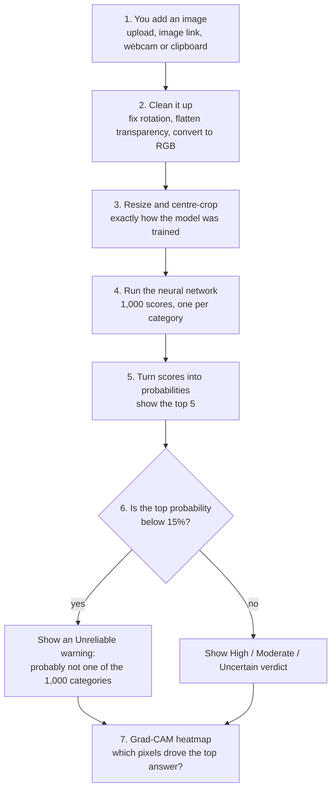
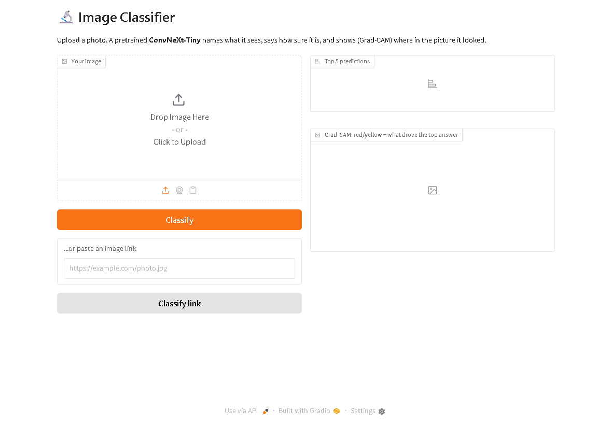
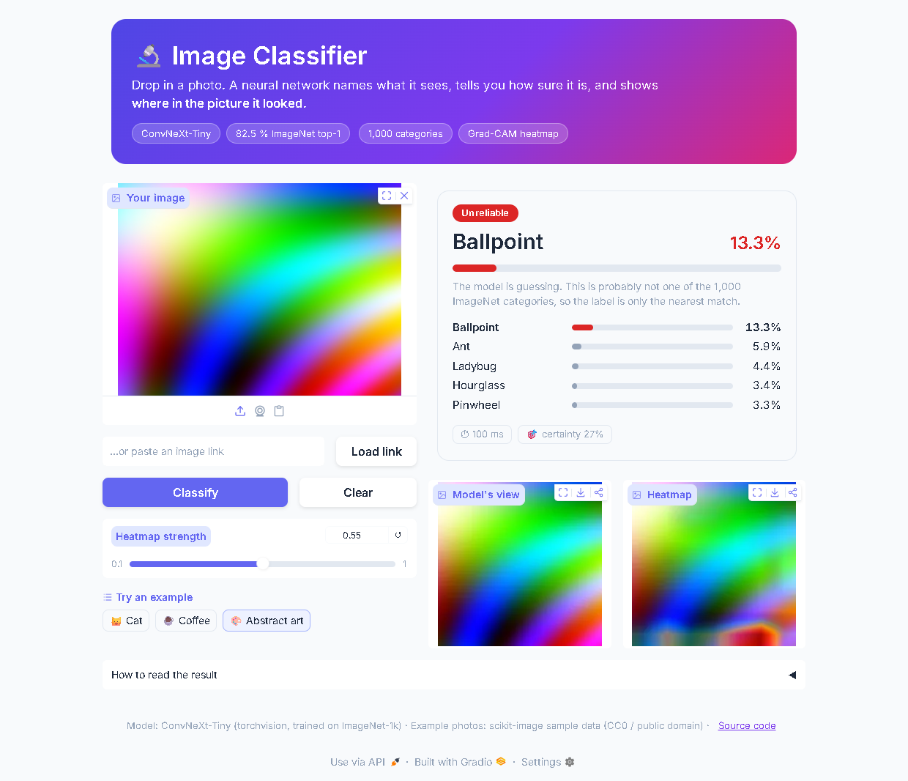
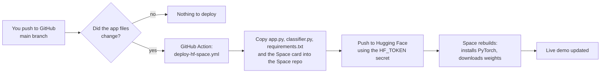

# 🔬 Image Classifier

Upload a photo and see **what an AI thinks it is, how sure it is, and where in the picture it looked**.

**[Open the live demo](https://huggingface.co/spaces/Laavanjan/image-classifier)** - no install needed.


## In plain English

An *image classifier* is a program that looks at a picture and names what is in it. The model here, **ConvNeXt-Tiny**,
was trained by researchers on ImageNet, a collection of about 1.3 million photos sorted into **1,000 categories**
(tiger cat, balloon, espresso, school bus, …). This app lets you try it on your own images and, more importantly,
helps you judge whether to **trust** an answer:

- **Confidence** - how sure the model is, as a percentage.
- **Heatmap (Grad-CAM)** - the red/yellow areas show which parts of the photo pushed the model towards its answer.
- **Warnings** - if the model is guessing, the app says so instead of presenting a wrong label as fact.

## How the app works (the flow)



## Using it, step by step

The demo runs on a free Hugging Face Space, so after a quiet period the first visit can take about 30 seconds to wake up.

### 1. Add an image

Drop a file, use the webcam or clipboard, or **paste an image link** into the box under the upload area (it must be a
direct link to the picture itself, up to 15 MB). Then click **Classify** (or **Classify link**).



### 2. Read the result

- **Top 5 predictions** - the candidate categories and their probabilities.
- **Verdict** - a confidence badge (see the table below) and how long the model took.
- **Heatmap** - Grad-CAM for the top answer, drawn on the cropped image the model actually saw.

In the picture at the top, a cat photo was classified from a link: *Egyptian cat* 42 %, then *tiger cat* and *tabby*.
The heatmap lights up the cat's head and body, which is what you would hope for.

### 3. Know when the answer is not trustworthy

ImageNet has no category for many things (for example a hibiscus flower, or abstract art). The model must still pick
*something*, so it chooses the nearest match. When its top probability is under 15 %, the app flags the result as
**Unreliable** and explains why. This abstract colour pattern is called a *ballpoint* at only 11 %:



### Reading the confidence verdict

| Verdict | Top probability | What it means |
|---|---|---|
| High confidence | 70 % or more | The model is fairly sure. |
| Moderate confidence | 35 – 70 % | Probably right, check the runner-ups. |
| Uncertain | 15 – 35 % | Several answers are close; treat as a guess. |
| Unreliable | under 15 % | Likely outside the 1,000 categories. The label is only the nearest match. |

These thresholds are simple rules of thumb on the model's output, not a calibrated probability of being correct.

## Run it on your own computer

```powershell
python -m venv .venv
.\.venv\Scripts\python -m pip install -r requirements.txt
.\.venv\Scripts\python app.py
```

Then open http://127.0.0.1:7860. The first start downloads the ConvNeXt-Tiny weights (about 110 MB) into
`~/.cache/torch`. A GPU is used automatically if available.

## Deployment

The live demo is deployed automatically. Pushing to `main` updates the Hugging Face Space:



- **One-time setup:** create a Hugging Face *Write* token and add it to the GitHub repo as an Actions secret named
  `HF_TOKEN` (Settings → Secrets and variables → Actions). The workflow is
  [`.github/workflows/deploy-hf-space.yml`](.github/workflows/deploy-hf-space.yml) and can also be started by hand from the Actions tab.
- **Why Gradio:** a free Space does not offer Streamlit or Docker, so the app is built with Gradio. Its prediction
  function is wrapped in `@spaces.GPU` so it also starts on ZeroGPU hardware; on plain CPU the decorator does nothing.
- **The Space card** ([`hf_space/README.md`](hf_space/README.md)) holds the Space's title, SDK and Gradio version.
  Keep its `sdk_version` equal to the `gradio==` pin in `requirements.txt`.

## The model

The demo uses **ConvNeXt-Tiny**: 28.6 M parameters, 82.5 % ImageNet top-1 accuracy (torchvision's published score for
these weights), about 110 MB, and fast on a CPU. To try another model, change `MODEL_KEY` in `app.py`; `classifier.py`
also knows ResNet-50, ResNet-101, ConvNeXt-Small and EfficientNet-V2-S.

Latency is measured by [`benchmark.py`](benchmark.py): CPU only, one image at a time, 20 runs, median (4-thread Intel CPU).
Latency depends only on the architecture, so the benchmark uses random weights and downloads nothing.

| Model | Params (M) | ImageNet top-1 (%) | Input | Median latency (ms) | Grad-CAM (ms) |
|---|---:|---:|---:|---:|---:|
| ResNet-50 | 25.6 | 80.9 | 224² | 125 | 374 |
| ResNet-101 | 44.5 | 81.9 | 224² | 207 | 722 |
| **ConvNeXt-Tiny (used)** | 28.6 | 82.5 | 224² | 98 | 351 |
| ConvNeXt-Small | 50.2 | 83.6 | 224² | 175 | 639 |
| EfficientNet-V2-S | 21.5 | 84.2 | 384² | 231 | 919 |

ConvNeXt-Tiny is both faster and 1.6 points more accurate than ResNet-50 on this CPU, which is why it is the demo's
model. Run `python benchmark.py --write` to regenerate [`docs/benchmarks.md`](docs/benchmarks.md) on your own machine.

## Under the hood

| Step in the flow | Where it happens |
|---|---|
| 1–2. Load and clean the image | `_to_rgb`, `load_image_from_url` in `app.py` / `classifier.py` |
| 3–5. Preprocess, predict, top-5 | `ImageClassifier.predict` in `classifier.py` |
| 6. Confidence bands and the unreliable warning | `confidence_level` in `classifier.py` |
| 7. Grad-CAM | `ImageClassifier.grad_cam`, `overlay_heatmap` in `classifier.py` |
| Interface, link box, GPU wrapper | `app.py` (Gradio) |

**Grad-CAM in one paragraph** ([Selvaraju et al., 2017](https://arxiv.org/abs/1610.02391)): take the network's last
convolutional layer, work out how much each of its feature maps contributed to the chosen class score, add the maps
together using those contributions as weights, keep only the positive part, and stretch the result back over the
image. Bright areas are where the evidence for that class came from.

Project layout:

```
app.py               the Gradio interface (the live demo)
classifier.py        model registry, inference, Grad-CAM, image loading
requirements.txt     dependencies (CPU PyTorch + Gradio)
hf_space/README.md   the Hugging Face Space card (title, SDK, Gradio version)
benchmark.py         CPU latency benchmark for every model
tests/               pytest suite (45 tests)
docs/                benchmarks and screenshots
.github/workflows/   CI (tests plus an app start-up check) and auto-deploy to the Space
```

## Testing

```powershell
.\.venv\Scripts\python -m pip install pytest
.\.venv\Scripts\python -m pytest
```

Every architecture is tested with random weights (valid probabilities, Grad-CAM shape and range, no leftover hooks,
correct crop size). A separate test loads the real ResNet-50 to check it is deterministic and unsure about a blank
image. Image-handling tests cover transparency, EXIF rotation, corrupt files and rejection of non-HTTP URLs.

## Limitations

- **Closed vocabulary.** Only the 1,000 ImageNet categories exist for this model. The warning helps but cannot fix this.
- **Confidence is not accuracy.** A 90 % prediction is not right 90 % of the time.
- **Heatmaps are coarse** and show what influenced the score, not a proof of reasoning.
- **One model.** The demo runs a single model; transformer models (ViT, Swin) are not included because they need a
  different explanation method.

## Roadmap

- Open-vocabulary mode with CLIP so you can type your own labels (e.g. "hibiscus")
- Calibration (temperature scaling) and a reliability diagram
- A model picker and comparison table in the demo
- Transformer models with attention-based explanations
