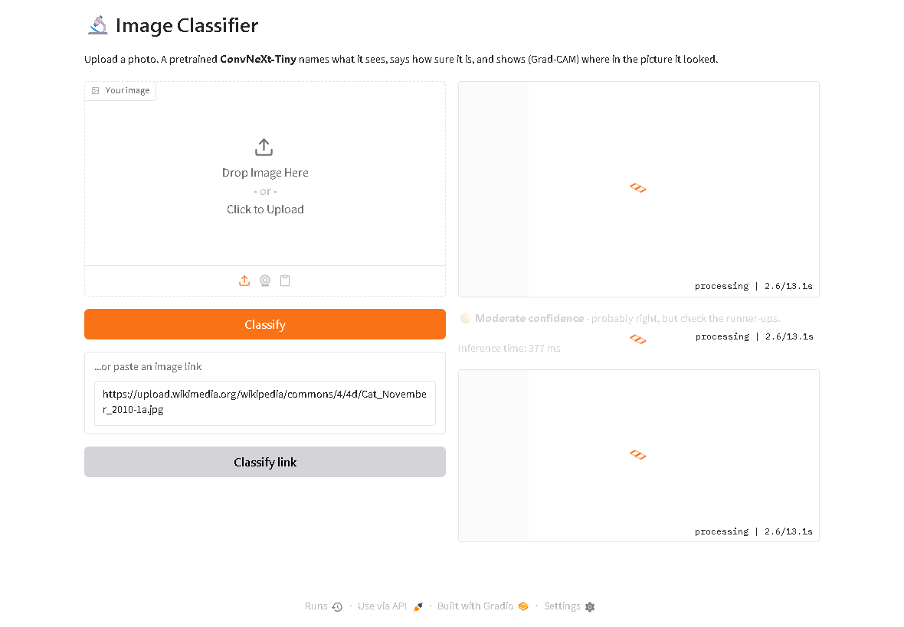
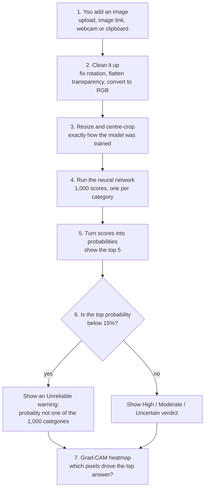
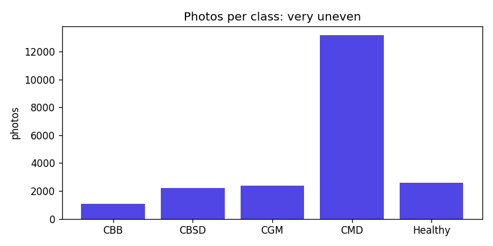
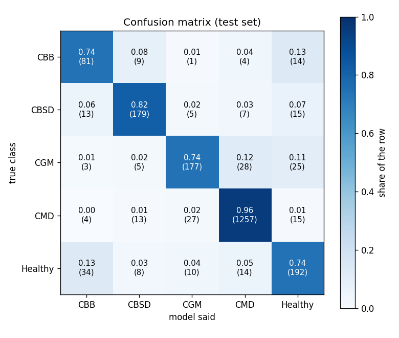
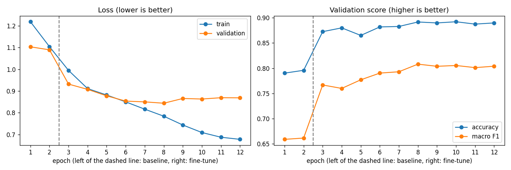
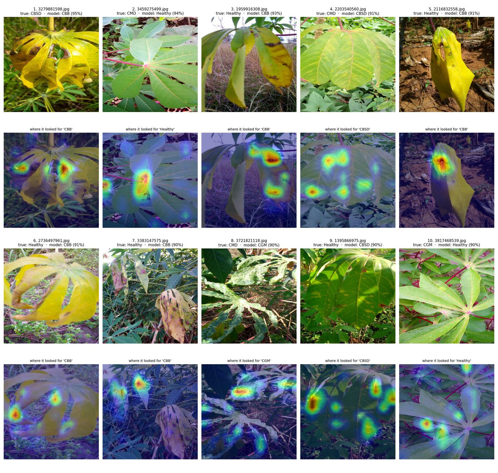

# 🔬 Image Classifier

Upload a photo and see **what an AI thinks it is, how sure it is, and where in the picture it looked**.

**[Open the live demo](https://huggingface.co/spaces/Laavanjan/image-classifier)** - no install needed.

**Fine-tuned on a real problem:** the same model, retrained to spot cassava leaf diseases, reaches **88.1 % test
accuracy** on 21,397 farm photos. [See the results and the mistakes it makes](#fine-tuning-spotting-cassava-leaf-diseases),
or [the full run on Kaggle](https://www.kaggle.com/code/laavanjan/cassava-leaf-disease-fine-tuning-convnext-tiny).



## In plain English

An *image classifier* is a program that looks at a picture and names what is in it. The model here, **ConvNeXt-Tiny**,
was trained by researchers on ImageNet, a collection of about 1.3 million photos sorted into **1,000 categories**
(tiger cat, balloon, espresso, school bus, …). This app lets you try it on your own images and, more importantly,
helps you judge whether to **trust** an answer:

- **Confidence** - how sure the model is, as a percentage.
- **Heatmap (Grad-CAM)** - the red/yellow areas show which parts of the photo pushed the model towards its answer.
- **Warnings** - if the model is guessing, the app says so instead of presenting a wrong label as fact.

## How the app works (the flow)



## Using it, step by step

The demo runs on a free Hugging Face Space, so after a quiet period the first visit can take about 30 seconds to wake up.

### 1. Add an image

Click one of the **Try an example** buttons (cat, coffee, abstract art), or drop in a file, use the webcam or
clipboard, or **paste an image link** into the box under the upload area and click **Load link** (it must be a direct
link to the picture itself, up to 15 MB). Then click **Classify**; files and examples classify as soon as they load.


### 2. Read the result

- **Result card** - the top answer and its probability, a colour-coded confidence badge (see the table below),
  a plain-English hint, the top 5 candidates as bars, how long the model took and how certain it was.
- **Model's view** - the resized, centre-cropped picture the network actually received.
- **Heatmap** - Grad-CAM for the top answer drawn on that crop. Drag **Heatmap strength** to fade it in or out; this
  redraws instantly without running the model again.

In the picture at the top, the cat example comes out as *Egyptian cat* at 67.9 % (moderate confidence), with *tabby*
and *tiger cat* as runner-ups. The heatmap lights up the cat's face, which is what you would hope for.

### 3. Know when the answer is not trustworthy

ImageNet has no category for many things (for example a hibiscus flower, or abstract art). The model must still pick
*something*, so it chooses the nearest match. When its top probability is under 15 %, the app flags the result as
**Unreliable** and explains why. This abstract colour pattern is called a *ballpoint* at only 13 %:


### Reading the confidence verdict

| Verdict | Top probability | What it means |
|---|---|---|
| High confidence | 70 % or more | The model is fairly sure. |
| Moderate confidence | 35 – 70 % | Probably right, check the runner-ups. |
| Uncertain | 15 – 35 % | Several answers are close; treat as a guess. |
| Unreliable | under 15 % | Likely outside the 1,000 categories. The label is only the nearest match. |

These thresholds are simple rules of thumb on the model's output, not a calibrated probability of being correct.

## Run it on your own computer

```powershell
python -m venv .venv
.\.venv\Scripts\python -m pip install -r requirements.txt
.\.venv\Scripts\python app.py
```

Then open http://127.0.0.1:7860. The first start downloads the ConvNeXt-Tiny weights (about 110 MB) into
`~/.cache/torch`. A GPU is used automatically if available.

## Deployment

The live demo is deployed automatically. Pushing to `main` updates the Hugging Face Space:


- **One-time setup:** create a Hugging Face *Write* token and add it to the GitHub repo as an Actions secret named
  `HF_TOKEN` (Settings → Secrets and variables → Actions). The workflow is
  [`.github/workflows/deploy-hf-space.yml`](.github/workflows/deploy-hf-space.yml) and can also be started by hand from the Actions tab.
- **Why Gradio:** a free Space does not offer Streamlit or Docker, so the app is built with Gradio. Its prediction
  function is wrapped in `@spaces.GPU` so it also starts on ZeroGPU hardware; on plain CPU the decorator does nothing.
- **The Space card** ([`hf_space/README.md`](hf_space/README.md)) holds the Space's title, SDK and Gradio version.
  Keep its `sdk_version` equal to the `gradio==` pin in `requirements.txt`.

## The model

The demo uses **ConvNeXt-Tiny**: 28.6 M parameters, 82.5 % ImageNet top-1 accuracy (torchvision's published score for
these weights), about 110 MB, and fast on a CPU. To try another model, change `MODEL_KEY` in `app.py`; `classifier.py`
also knows ResNet-50, ResNet-101, ConvNeXt-Small and EfficientNet-V2-S.

Latency is measured by [`benchmark.py`](benchmark.py): CPU only, one image at a time, 20 runs, median (4-thread Intel CPU).
Latency depends only on the architecture, so the benchmark uses random weights and downloads nothing.

| Model | Params (M) | ImageNet top-1 (%) | Input | Median latency (ms) | Grad-CAM (ms) |
|---|---:|---:|---:|---:|---:|
| ResNet-50 | 25.6 | 80.9 | 224² | 125 | 374 |
| ResNet-101 | 44.5 | 81.9 | 224² | 207 | 722 |
| **ConvNeXt-Tiny (used)** | 28.6 | 82.5 | 224² | 98 | 351 |
| ConvNeXt-Small | 50.2 | 83.6 | 224² | 175 | 639 |
| EfficientNet-V2-S | 21.5 | 84.2 | 384² | 231 | 919 |

ConvNeXt-Tiny is both faster and 1.6 points more accurate than ResNet-50 on this CPU, which is why it is the demo's
model. Run `python benchmark.py --write` to regenerate [`docs/benchmarks.md`](docs/benchmarks.md) on your own machine.

## Fine-tuning: spotting cassava leaf diseases

Cassava is a main food for many millions of people in Africa, and leaf diseases can destroy a harvest. To show the
whole machine-learning job, not only using a ready-made model, ConvNeXt-Tiny was **fine-tuned** to tell 4 cassava
diseases and healthy leaves apart, using the [Kaggle Cassava Leaf Disease](https://www.kaggle.com/competitions/cassava-leaf-disease-classification)
photos: 21,397 pictures taken by farmers in Uganda.

Everything is in one notebook, [`notebooks/cassava_finetune.ipynb`](notebooks/cassava_finetune.ipynb), which runs on
a free Kaggle GPU in under an hour. **[See the full run with every output on Kaggle](https://www.kaggle.com/code/laavanjan/cassava-leaf-disease-fine-tuning-convnext-tiny).**

### The data is very uneven



61.5 % of the photos show one disease, **CMD (mosaic)**. A model that always answers "CMD" is right 61.5 % of the time
while being useless for every other class. That is why the results below also use **macro F1**: the F1 score of each
class, averaged, so every class counts the same.

### How it was trained

- **Split:** 80 % train, 10 % validation, 10 % test, with the same class mix in each (seed 42). The test photos were
  used only once, at the very end.
- **Step 1, baseline:** keep the ImageNet layers frozen and train only a new last layer (2 epochs).
- **Step 2, fine-tune:** train every layer with a smaller learning rate (10 epochs) and keep the epoch with the best
  validation macro F1.
- **Details:** 384 × 384 input, random crops, flips and colour changes, AdamW with a cosine schedule, label smoothing
  0.1 (some labels in this dataset are wrong), class weights so small classes are not ignored, and mixed precision.
  Training took 49 minutes on one Tesla T4.

### Results (2,140 test photos the model never saw)

| Model | Test accuracy | Test macro F1 |
|---|---:|---:|
| Always answer "CMD" (the biggest class) | 61.5 % | 0.152 |
| Baseline: only the last layer trained | 79.4 % | 0.662 |
| **Fine-tuned: all layers trained** | **88.1 %** | **0.792** |

| Class | Test photos | Precision | Recall | F1 |
|---|---:|---:|---:|---:|
| CBB (bacterial blight) | 109 | 0.600 | 0.743 | 0.664 |
| CBSD (brown streak) | 219 | 0.836 | 0.817 | 0.827 |
| CGM (green mottle) | 238 | 0.805 | 0.744 | 0.773 |
| CMD (mosaic) | 1,316 | 0.960 | 0.955 | 0.957 |
| Healthy | 258 | 0.736 | 0.744 | 0.740 |

For comparison, the best competition scores were about 91 % accuracy, but on Kaggle's hidden test set (different
photos) and usually from several large models combined. This is one small model trained once.





### What the results show

- **Fine-tuning every layer matters:** +8.7 points of accuracy and +0.13 macro F1 over training only the last layer.
- **CBB is the weakest class.** It is the smallest (5 % of photos), and the class weight pushes the model to say "CBB"
  more often: it finds 74 % of real CBB leaves (recall), but only 60 % of its "CBB" answers are right (precision).
  Most of the false alarms are leaves labelled Healthy (34 of them in the confusion matrix).
- **CGM and CMD get mixed up** (28 and 27 photos), which makes sense: both make leaves look mottled yellow and green.
- **The model starts to overfit after fine-tune epoch 6** (epoch 8 on the chart): training loss keeps falling, but
  validation loss stops improving and goes up a little (0.844 → 0.869). The notebook kept epoch 6 automatically.

### The 10 mistakes it was most sure about

These are the test photos where the model was wrong but at least 90 % sure. Each one is shown above its Grad-CAM
heatmap (where the model looked for its answer).



| # | Label | Model said | What the photo shows | Likely reason |
|---|---|---|---|---|
| 1 | CBSD | CBB (95 %) | Yellow, wilting leaves with brown dead patches; the heatmap is on the patches. | Dead patches and wilting are CBB signs. CBSD does its worst damage in the roots, which a leaf photo can't show. Wrong label, or both diseases. |
| 2 | CMD | Healthy (94 %) | Flat, clean green leaves, no mosaic pattern. | Probably a wrong label, or the sick leaves were at the sides of the photo: the centre crop cuts off about 30 % of the width. |
| 3 | Healthy | CBB (93 %) | Yellow leaves with dark brown spots. | Doesn't look healthy: probably a wrong label. |
| 4 | CMD | CBSD (91 %) | Yellow patches along the veins; the leaf is not twisted. | Yellowing along the veins looks like CBSD, while CMD usually twists the leaves. A hard look-alike. |
| 5 | Healthy | CBB (91 %) | One wilted yellow leaf with brown spots. | Wilting and spots are CBB signs: probably a wrong label, or an old leaf dying. |
| 6 | Healthy | CBB (91 %) | Yellow, drooping leaves with brown edges. | Same as #3 and #5: probably a wrong label. |
| 7 | Healthy | CBB (90 %) | A mostly green plant with a few dried, spotted leaves; the heatmap is on those leaves. | The label describes the whole plant, the model reacted to the few bad leaves. An unclear label. |
| 8 | CMD | CGM (90 %) | Mottled yellow-green, slightly narrow leaves. | CMD and CGM both cause mottling. A hard look-alike. |
| 9 | Healthy | CBSD (90 %) | A green leaf with small yellow blotches, in strong sun and shadow. | The model may read sunlight spots as disease blotches. A model weakness (or very early CBSD). |
| 10 | CGM | Healthy (90 %) | Bright green leaves; any symptoms are very faint. | Mild CGM is hard to see. A model weakness. |

**What this says:** about half of the most confident mistakes (#2, #3, #5, #6, #7) look like **wrong or unclear labels**,
two are **look-alike diseases** (#4, #8), and two are **real model weaknesses** (#9 sunlight, #10 very mild symptoms).
In every case the heatmap sits on the leaves, mostly on spots and yellow patches, not on soil or sky, so the model
looks at the right things even when it is wrong. These are a careful reading of the photos, not an expert diagnosis.

### Limits and next steps

- All photos come from one survey, so the score on photos from other places and phones is still unknown. Next step:
  test on outside photos (the notebook has a section for this).
- It is a study project, not a diagnosis tool: a farmer should still get an expert to confirm.
- Ideas to try, one at a time: a bigger input (448 or 512), no class weights (to see the CBB precision/recall
  trade-off), about 6 epochs instead of 10, and adding the model to the live demo.

## Under the hood

| Step in the flow | Where it happens |
|---|---|
| 1–2. Load and clean the image | `_to_rgb` in `app.py`, `load_image_from_url` in `classifier.py` |
| 3–5. Preprocess, predict, top-5 | `ImageClassifier.predict` in `classifier.py` |
| 6. Confidence bands and the unreliable warning | `confidence_level` in `classifier.py` |
| 7. Grad-CAM | `ImageClassifier.grad_cam`, `overlay_heatmap` in `classifier.py` |
| Interface, link box, GPU wrapper | `app.py` (Gradio) |

**Grad-CAM in one paragraph** ([Selvaraju et al., 2017](https://arxiv.org/abs/1610.02391)): take the network's last
convolutional layer, work out how much each of its feature maps contributed to the chosen class score, add the maps
together using those contributions as weights, keep only the positive part, and stretch the result back over the
image. Bright areas are where the evidence for that class came from.

Project layout:

```
app.py               the Gradio interface (the live demo)
examples/            the three example photos (CC0 / public domain, from scikit-image's sample data)
classifier.py        model registry, inference, Grad-CAM, image loading
requirements.txt     dependencies (CPU PyTorch + Gradio)
hf_space/README.md   the Hugging Face Space card (title, SDK, Gradio version)
benchmark.py         CPU latency benchmark for every model
notebooks/           Kaggle notebook: fine-tune ConvNeXt-Tiny to spot cassava leaf diseases
tests/               pytest suite (45 tests)
docs/                benchmarks, screenshots and the cassava results (docs/cassava/)
.github/workflows/   CI (tests plus an app start-up check) and auto-deploy to the Space
```

## Testing

```powershell
.\.venv\Scripts\python -m pip install pytest
.\.venv\Scripts\python -m pytest
```

Every architecture is tested with random weights (valid probabilities, Grad-CAM shape and range, no leftover hooks,
correct crop size). A separate test loads the real ResNet-50 to check it is deterministic and unsure about a blank
image. Image-handling tests cover transparency, EXIF rotation, corrupt files and rejection of non-HTTP URLs.

## Limitations

- **Closed vocabulary.** Only the 1,000 ImageNet categories exist for this model. The warning helps but cannot fix this.
- **Confidence is not accuracy.** A 90 % prediction is not right 90 % of the time.
- **Heatmaps are coarse** and show what influenced the score, not a proof of reasoning.
- **One model.** The demo runs a single model; transformer models (ViT, Swin) are not included because they need a
  different explanation method.

## Roadmap

- Cassava mode in the live demo, using the fine-tuned model
- Open-vocabulary mode with CLIP so you can type your own labels (e.g. "hibiscus")
- Calibration (temperature scaling) and a reliability diagram
- A model picker and comparison table in the demo
- Transformer models with attention-based explanations
