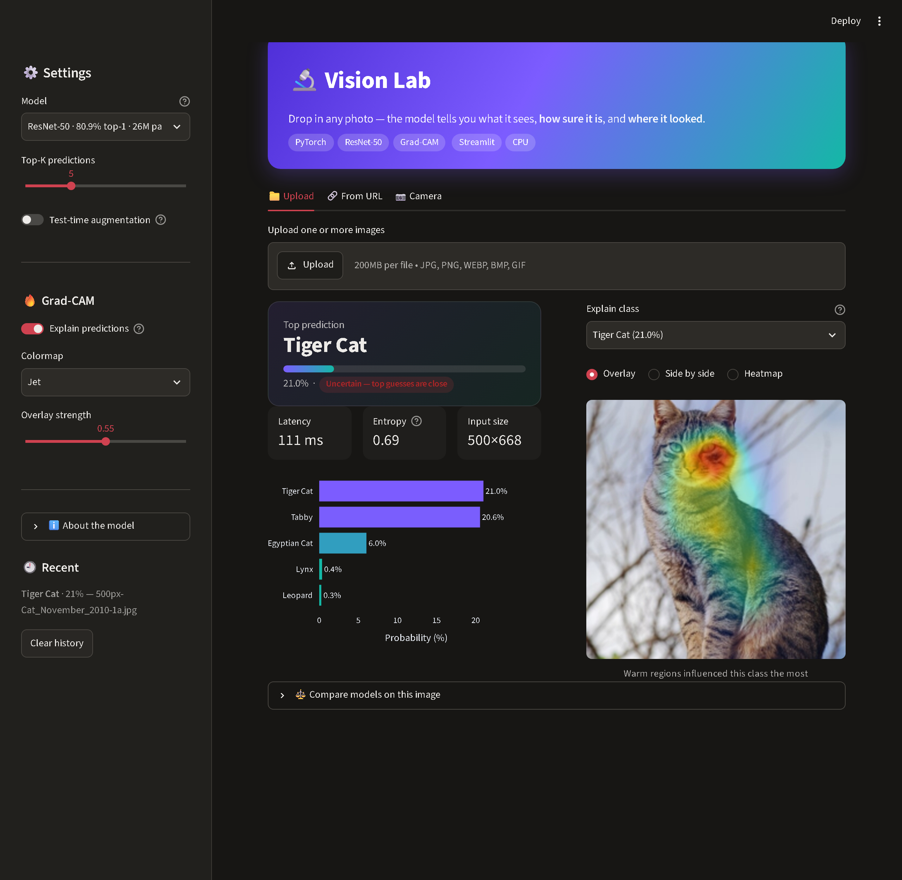
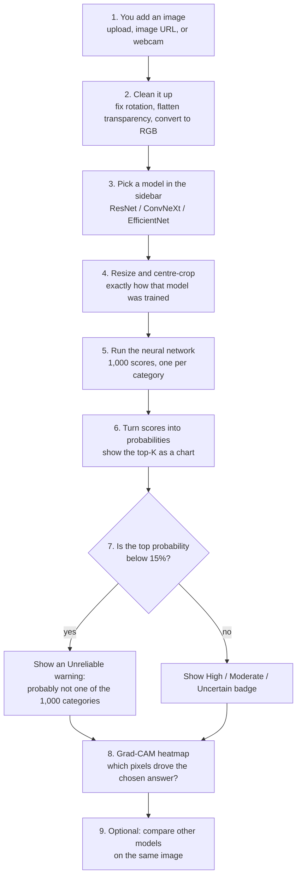
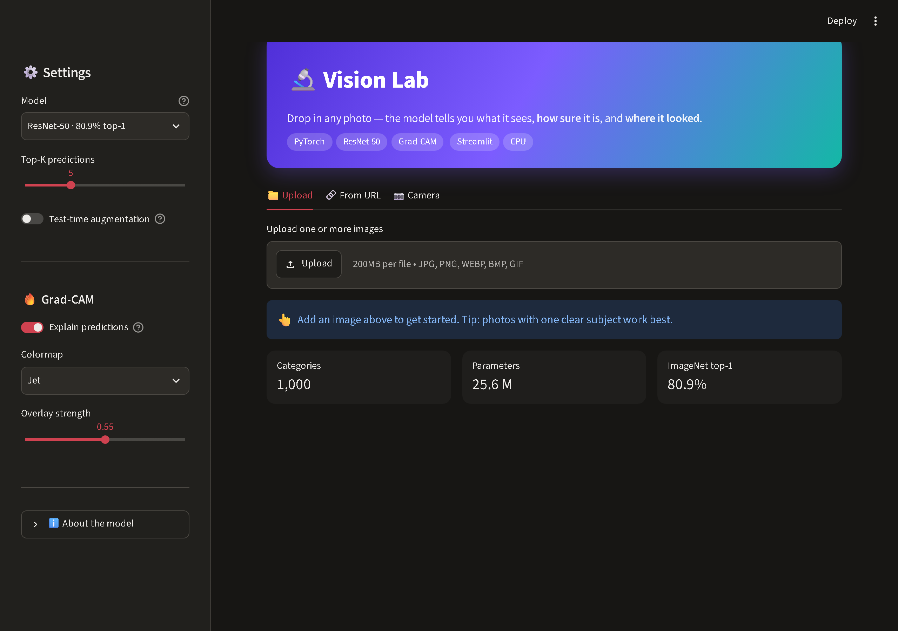
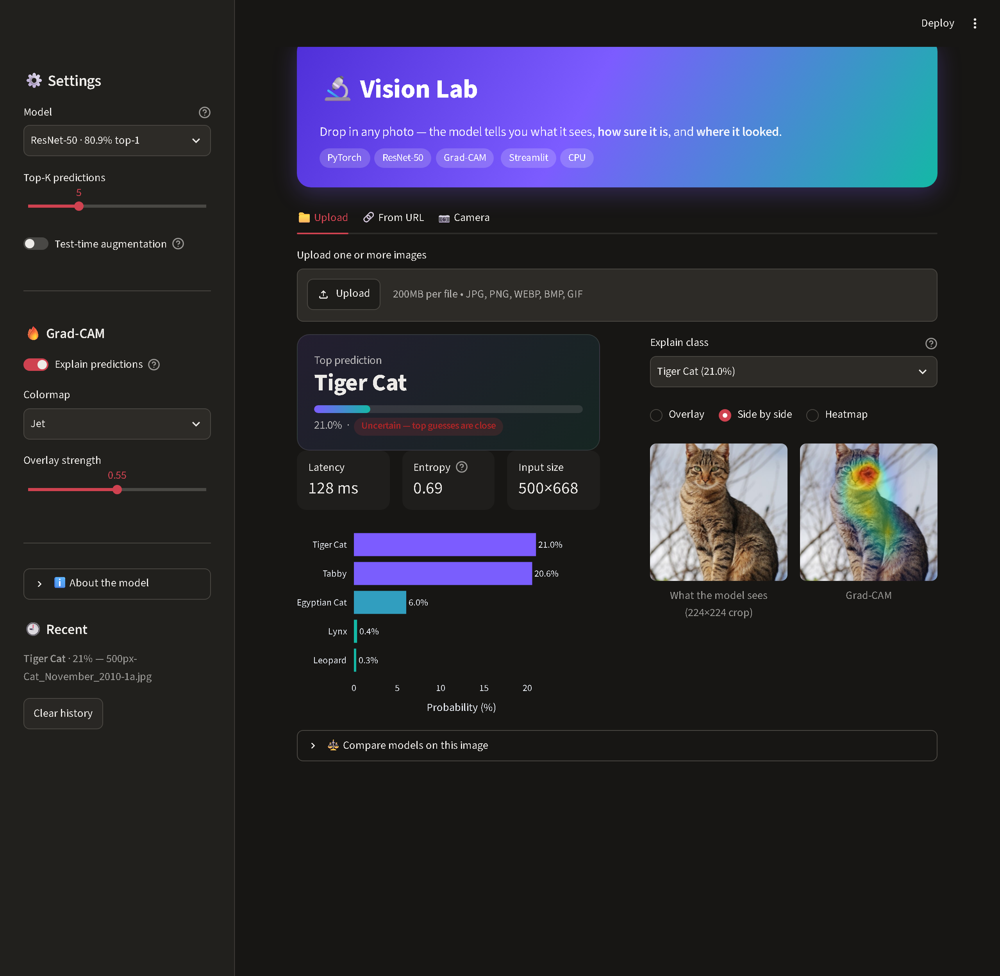
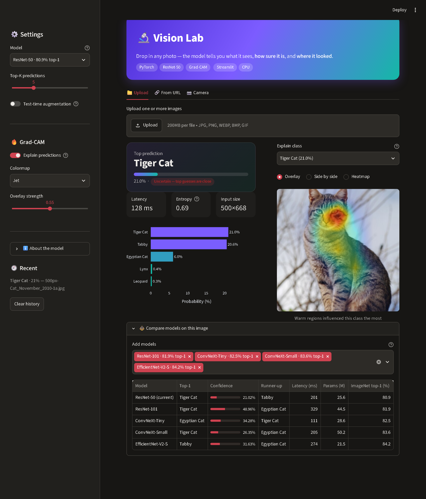
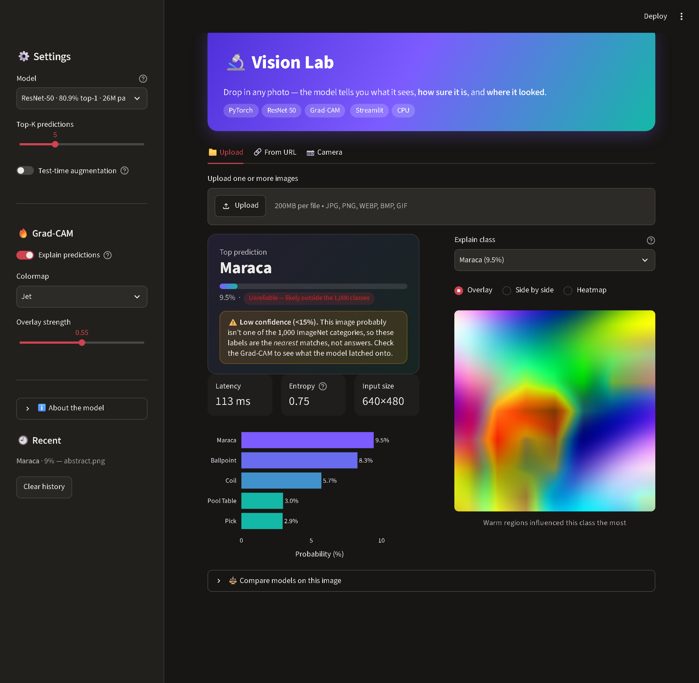

# 🔬 ImageNet Model Explorer

Upload a photo and see **what an AI thinks it is, how sure it is, and where in the picture it looked**.
Compare five different pretrained image-recognition models on the same photo and see where they disagree.
(In the app itself the header says *Vision Lab*.)



## In plain English

An *image classifier* is a program that looks at a picture and names what is in it. The five models here were
trained by researchers on ImageNet, a collection of about 1.3 million photos sorted into **1,000 categories**
(tiger cat, balloon, espresso, school bus, …). This app lets you try them on your own images and, more importantly,
helps you judge whether to **trust** an answer:

- **Confidence** — how sure the model is, as a percentage.
- **Heatmap (Grad-CAM)** — the red/yellow areas show which parts of the photo pushed the model towards its answer.
- **Warnings** — if the model is guessing, the app says so instead of presenting a wrong label as fact.
- **Comparison** — run several models on one image and see where they agree or disagree.

## How the app works (the flow)



## Using it, step by step

### 1. Open the app and add an image

Start the app (see [Quick start](#quick-start)) and you get this screen. The three tabs at the top are the ways to
give it an image: **Upload** (one or many files), **From URL** (paste a link to an image) and **Camera** (webcam).
The sidebar on the left holds the settings.



### 2. Read the result

Once an image is loaded you see:

- **Top prediction** — the most likely category, its probability and a confidence badge.
- **Latency / Entropy / Input size** — how long the model took, how spread-out its guesses were
  (0 = certain, 1 = completely undecided) and the size of your image.
- **Bar chart** — the top-K candidates (set K in the sidebar, 3–10).
- **Heatmap** — Grad-CAM for any candidate you pick under *Explain class*.

In the picture above, the model's top two guesses (*tiger cat* 21 % and *tabby* 20.6 %) are almost tied, so the
badge says **Uncertain**. The heatmap shows it focused on the cat's face and body, which is what you would hope for.

### 3. Look at what the model actually sees

Switch the heatmap view to **Side by side** to compare the cropped image the model receives with the heatmap on top
of it. Models never see your full photo: it is resized and centre-cropped first, so anything outside the crop is ignored.



### 4. Compare models

Open **Compare models on this image**, add models, and a table shows each model's top answer, confidence,
runner-up, speed, size and published accuracy. Here five models see the same cat differently: three say *tiger cat*,
one *Egyptian cat*, one *tabby*. That is genuine ambiguity between cat categories, not a bug.



### 5. Know when the answer is not trustworthy

ImageNet has no category for many things (for example a hibiscus flower, or abstract art). The model must still pick
*something*, so it chooses the nearest match. When its top probability is under 15 %, the app flags the result as
**Unreliable** and explains why. This is an abstract image, and the model calls it a maraca at 9.5 %:



### Reading the confidence badge

| Badge | Top probability | What it means |
|---|---|---|
| High confidence | 70 % or more | The model is fairly sure. |
| Moderate confidence | 35 – 70 % | Probably right, check the runner-up. |
| Uncertain | 15 – 35 % | Several answers are close; treat as a guess. |
| Unreliable | under 15 % | Likely outside the 1,000 categories. The label is only the nearest match. |

These thresholds are simple rules of thumb on the model's output, not a calibrated probability of being correct.

## Quick start

```powershell
python -m venv .venv
.\.venv\Scripts\python -m pip install -r requirements.txt
.\.venv\Scripts\python -m streamlit run app.py
```

On Windows, `run.bat` does the same. Then open http://localhost:8501.
The first use of each model downloads its weights from PyTorch into `~/.cache/torch`
(about 100 MB for ResNet-50, up to about 200 MB for the larger ones). A GPU is used automatically if available.

Tip: add `?url=<image-link>` to the address to open the app with an image already loaded, e.g.
`http://localhost:8501/?url=https://example.com/photo.jpg`.

### Docker

```bash
docker build -t imagenet-model-explorer .
docker run -p 8501:8501 imagenet-model-explorer
```

## The models

Accuracy is torchvision's published ImageNet top-1 score for the weights used. Latency is measured by
[`benchmark.py`](benchmark.py): CPU only, one image at a time, 20 runs, median (4-thread Intel CPU).
Latency depends only on the architecture, so the benchmark uses random weights and downloads nothing.

| Model | Params (M) | ImageNet top-1 (%) | Input | Median latency (ms) | Grad-CAM (ms) |
|---|---:|---:|---:|---:|---:|
| ResNet-50 | 25.6 | 80.9 | 224² | 125 | 374 |
| ResNet-101 | 44.5 | 81.9 | 224² | 207 | 722 |
| ConvNeXt-Tiny | 28.6 | 82.5 | 224² | 98 | 351 |
| ConvNeXt-Small | 50.2 | 83.6 | 224² | 175 | 639 |
| EfficientNet-V2-S | 21.5 | 84.2 | 384² | 231 | 919 |

On this CPU, ConvNeXt-Tiny is both faster and 1.6 points more accurate than ResNet-50. EfficientNet-V2-S is the most
accurate but slowest, because it reads a larger 384 px input. Run `python benchmark.py --write` to regenerate
[`docs/benchmarks.md`](docs/benchmarks.md) on your own machine.

## Under the hood

| Step in the flow | Where it happens |
|---|---|
| 1–2. Load and clean the image | `load_image_from_bytes`, `load_image_from_url` in `classifier.py` |
| 3. Model registry (weights, preprocessing, Grad-CAM layer per model) | `MODEL_SPECS` in `classifier.py` |
| 4–6. Preprocess, predict, top-K, entropy, optional flip averaging | `ImageClassifier.predict` |
| 7. Confidence bands and the unreliable warning | `confidence_level` |
| 8. Grad-CAM | `ImageClassifier.grad_cam`, `overlay_heatmap` |
| 9. Interface, caching, comparison table | `app.py` (Streamlit) |

**Grad-CAM in one paragraph** ([Selvaraju et al., 2017](https://arxiv.org/abs/1610.02391)): take the network's last
convolutional layer, work out how much each of its feature maps contributed to the chosen class score, add the maps
together using those contributions as weights, keep only the positive part, and stretch the result back over the
image. Bright areas are where the evidence for that class came from.

Project layout:

```
classifier.py        model registry, inference, Grad-CAM, image loading (no Streamlit dependency)
app.py               the Streamlit interface
benchmark.py         CPU latency benchmark for every model
tests/               pytest suite (45 tests)
docs/                benchmarks and screenshots
Dockerfile           container image
.github/workflows/   CI: tests plus an app smoke test
```

## Testing

```powershell
.\.venv\Scripts\python -m pip install pytest
.\.venv\Scripts\python -m pytest
```

Every architecture is tested with random weights (valid probabilities, Grad-CAM shape and range, no leftover hooks,
correct crop size). A separate test loads the real ResNet-50 to check it is deterministic and unsure about a blank
image. Image-handling tests cover transparency, EXIF rotation, corrupt files and rejection of non-HTTP URLs.

## Limitations

- **Closed vocabulary.** Only the 1,000 ImageNet categories exist for these models. The warning helps but cannot fix this.
- **Confidence is not accuracy.** A 90 % prediction is not right 90 % of the time.
- **Heatmaps are coarse** and show what influenced the score, not a proof of reasoning.
- Transformer models (ViT, Swin) are not included; they need a different explanation method.

## Roadmap

- Open-vocabulary mode with CLIP so you can type your own labels (e.g. "hibiscus")
- Calibration (temperature scaling) and a reliability diagram
- Transformer models with attention-based explanations
- Hosted demo
